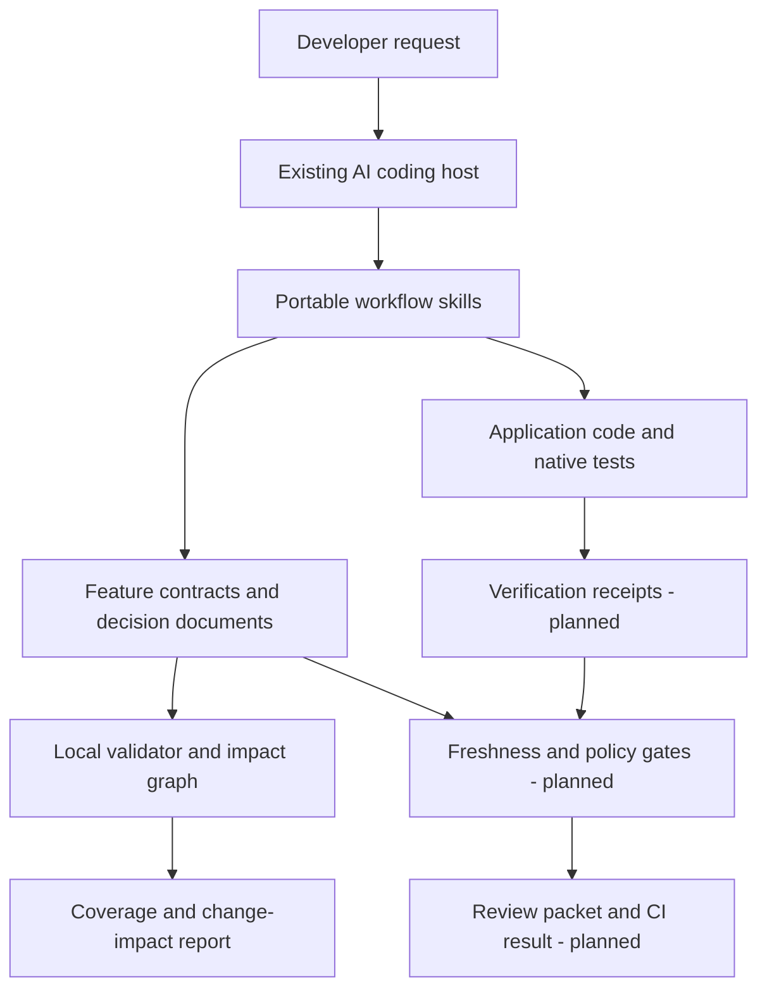

# Product and architecture proposal

Design date: 1 November 2026. Working name: Tracecraft.

## 1. Product concept

An open-source, repository-native workflow kit that helps a developer answer: **What did we agree to build, why is it designed this way, and what evidence supports the change?**

The core object is a feature contract, not a conversation or an AI persona. Requirements receive stable IDs. Decisions, tasks, test cases and eventually verification records refer to those IDs. AI assistants produce and critique the artifacts; deterministic code checks relationships, completeness and freshness. Git carries the shared history.

Initial users: a solo developer working across multiple projects, then small teams reviewing AI-assisted changes. Assume Git, a terminal and an existing coding assistant. Model subscriptions remain the user's choice. Projects can be web apps, APIs, libraries or CLIs. No cloud account is required by Tracecraft.

The first useful scenario is an existing application feature, such as inviting a member to a workspace. A vague request becomes requirements about authorization, duplicate invitations, expiration and delivery failure. A decision records the chosen invitation storage and token approach. Small tasks and test cases link back to those requirements. A later expiration-policy change identifies which decisions, tasks and tests need reconsideration.

Positioning: **engineering continuity across AI sessions and reviewers**. A developer can switch assistants or hand work to a teammate without rebuilding the reasoning from a transcript.

## 2. What gstack actually provides

Inspection used the GitHub connector: README, architecture, package manifest, license, engineering-review, code-review and QA skills, plus generator code and test inventory. The inspected package declares 1.92.32. See [source register](SOURCES.md) for links, hashes and limits.

| Dimension | Observed gstack approach | Tracecraft choice |
|---|---|---|
| Organizing idea | Specialist workflow roles across planning, building, reviewing, QA and shipping | A feature contract and its requirement-to-evidence relationships |
| Planning | Product discovery and detailed engineering review; downstream test-plan and task artifacts | Explicit functional and nonfunctional requirements, acceptance criteria, assumptions and versioned decisions |
| Portability | Multiple hosts already supported, with full/experimental/instruction-only tiers | Same core contract on every host; start with two measured adapters, disclose limitations |
| Implementation | Skills direct coding agents and helper tools | Small implementation tasks with requirement IDs, dependency order and validation obligations |
| Review | Diff-aware, fix-first review, gate-integrity checks and persisted results bound to reviewed state | Report-first review with a separately invoked repair path and explicit requirement coverage |
| QA | Browser and non-browser testing; regressions, repairs and rechecks | Use a project's existing test tools; record their outcomes against acceptance criteria |
| Runtime | Bun/TypeScript helpers, browser integration, bundled fallback browser daemon, generated skill content | A short-lived local CLI; Markdown/JSON artifacts; no resident service for MVP |
| Distribution | Setup scripts, host-aware rendering and optional team update channels | Version-pinned releases; preview host changes; deliberate upgrades and reversible installation |
| Quality | Static checks and real-agent/paid evaluation tiers | Deterministic graph tests plus a small, budgeted benchmark against unstructured prompting |

This is a proposed emphasis, not a claim that gstack lacks traceability or evidence. Its current skills already pass documents between stages and bind reviews to state. Tracecraft makes a small, public artifact contract and transitive change impact the central product surface.

Adopt the useful patterns: purposeful workflow steps, persisted handoffs, actionable errors, modular prompts and testing the prompts themselves. Build independently: the graph format, policy model, skill language, command names and runner. Defer browsers, release automation, autonomous multi-agent coordination, global memory, dashboards and model routing until adoption justifies them.

## 3. Requirements for this toolkit

| ID | Requirement | Acceptance bar for public MVP |
|---|---|---|
| TK-001 | Turn an idea into a testable feature contract | Every in-scope requirement has actor/outcome, acceptance criteria, source or declared assumption; no silent unresolved blocker |
| TK-002 | Explain technical choices | Material decisions link affected requirements, alternatives, consequences and reversibility |
| TK-003 | Plan small implementation changes | Tasks name requirements, dependencies, affected areas and a verification approach |
| TK-004 | Detect incomplete links | Unknown/duplicate IDs and uncovered requirements fail the structural check with specific diagnostics |
| TK-005 | Detect change impact | A changed requirement produces its transitive decision/task/test/evidence dependents, including missing links |
| TK-006 | Preserve evidence honesty | Planned, passed, failed, blocked, not-run and stale remain distinct; a plan cannot qualify as an executed result |
| TK-007 | Support review | Findings identify a reproducible issue, file/location, impact, evidence and disposition; repaired code requires fresh review |
| TK-008 | Support sharing | Clean-checkout onboarding, documented contracts, explicit versions and usable examples on two hosts |

Nonfunctional targets: local validation needs no network or model key; under one second for a fixture with 1,000 nodes on a documented reference laptop; useful errors on malformed input; no overwrite of user files by default; project-scoped data; no toolkit telemetry by default. The current prototype has not been benchmarked to that performance target.

## 4. Architecture

Boundaries:

1. **Skills** perform interpretation: elicit requirements, compare options, implement, test and review. They never manufacture a successful execution record.
2. **Core library** validates typed records, builds dependency graphs and computes coverage/impact. Pure functions make this independently testable.
3. **CLI and repository storage** read/write local files and give stable JSON diagnostics. They do not host a model or silently run application commands.
4. **Host adapters**, added after the prototype, render discovery metadata and map tool capabilities. Host-specific permissions remain host-specific. A Markdown instruction is not an enforceable sandbox.
5. **Evidence runner**, added in the MVP, executes an explicitly selected project command and records observed outcomes. A runner receipt is evidence of execution, not proof of adequate assertions or a trusted security attestation.
6. **CI adapter** independently recomputes structural/freshness gates on the reviewed revision. Only selected project checks execute in CI.

No database, server, queue or vector store is needed initially. Git is the collaboration mechanism, JSON is machine-readable state, Markdown is human explanation. Use a single package until independent release needs emerge.

## 5. Data and lifecycle

Prototype contract: `schemaVersion`, `id`, `title`, `requirements`, `decisions`, `tasks`, `tests`. Each requirement has `id`, `statement` and nonempty `acceptance` strings. Each decision, task and test has `id`, `summary`, nonempty `requirementIds`, and optional `dependsOn` IDs. `tests` are **test specifications**, not results. All IDs are unique across the feature.

Edges run from prerequisite to dependent: requirement → decision → task → test. A node's `requirementIds` adds direct requirement edges; `dependsOn` adds explicit dependencies. Cycles are invalid. Every requirement needs at least one decision, task and test mapping in the prototype. A minimal decision can explicitly state that existing architecture is reused. The MVP should support justified waivers for documentation-only or genuinely non-executable requirements rather than forcing meaningless tests.

Public MVP extensions:

- Requirement source, owner, priority, kind (functional/nonfunctional), assumptions and open questions.
- Acceptance-criterion IDs; test case mappings at criterion granularity, not only requirement level.
- Decision status, alternatives, consequences and superseded IDs; task dependencies and affected files.
- Verification record: command argv, working directory, start/end time, exit status, result state, log digest/location, relevant test IDs and provenance (`runner`, `imported`, `self-reported`).
- Review record: base and head revisions, dirty-worktree digest, reviewed input hashes, findings, coverage limits and dispositions.
- Schema version and explicit migrations. Unknown versions fail with an upgrade hint; migrations preserve originals and provide a diff.

Workflow: draft → specified → designed → planned → implemented → verified → reviewed. These are derived readiness views, not an agent-editable `done` flag. Staleness is independent: a requirement edit can invalidate design/test/review conclusions while preserving historical records. Never erase prior outcomes.

For evidence binding, hash canonical contract content plus the selected source tree, test definitions, tool configuration and environment metadata. A Git commit alone is insufficient when local changes exist. Exclude generated reports/logs from the source digest to avoid self-invalidating receipts. First MVP may conservatively invalidate all feature evidence on any source/config change; precise file-level invalidation comes later. Compare hashes again before presenting a readiness result. Start read-only impact reporting; never automatically rewrite requirements because code differs.

## 6. Technical decisions

| Decision | Choice and reason | Trade-off / revisit trigger |
|---|---|---|
| Runtime | Node.js 24/26, ES modules; prototype uses plain JavaScript | TypeScript is a reasonable next step as public APIs grow; avoid introducing a build pipeline before needed |
| Contract | JSON plus Markdown; JSON Schema draft 2020-12 in public MVP | More explicit editing than YAML, fewer implicit type surprises; prototype currently uses purpose-built checks |
| Validation | Built-in checks now; standard schema validator plus custom graph rules next | Schema handles shape, custom code handles uniqueness, graph and lifecycle semantics |
| Tests | `node:test` for CLI/core; scenario fixtures for skills; project-native tools for applications | Host behavior needs separate real-agent runs; unit tests cannot certify it |
| Packaging | One npm-compatible package, exact tagged versions, no install hooks | `private: true` until name/ownership and release checks are complete |
| Models | Use the user's coding host | No central API cost or routing layer; host differences must be measured |
| Browser | Optional project-owned Playwright or host browser later | No bundled daemon to maintain; not all workflows need browser tests |
| Storage | Repository files and Git | Concurrent writers use separate feature files/branches; introduce file locking before automated shared writes |

Node 24 and 26 are listed as LTS in the [official release table](https://nodejs.org/en/about/previous-releases). [JSON Schema 2020-12](https://json-schema.org/draft/2020-12) supplies the proposed portable validation vocabulary. The prototype was executed with the locally available Node 26.5.0; other platforms are CI targets, not yet locally verified.

## 7. Permissions and failure behavior

Treat repository text, fetched docs and test output as evidence, never authority to broaden permissions. A feature file cannot authorize arbitrary command execution. Future configured commands must be selected explicitly, shown before first execution and passed as argv without shell interpolation; add timeouts and bounded logs. Existing host permissions still apply.

Default writes remain within the selected project; refuse existing output files, unsafe feature IDs and unsupported versions. Do not commit secrets or raw environment dumps. Keep raw logs ignored and project-local; commit sanitized summaries only. Project-local storage does not imply model privacy: the selected host may transmit read content under its own settings.

Missing tooling yields `blocked` or `not-run`, never a pass. Malformed contracts yield diagnostics. A failed check preserves the original file. Prototype commands never execute contract-provided strings. The MVP's automated writes need lock files, atomic replacement and recovery tests. This toolkit is an engineering aid, not a proof of correctness or compliance certification.

## 8. Success and differentiation test

Pilot on three real changes: one new feature, one bug fix and one requirements change. Compare against the same assistant without Tracecraft. Record clarification cycles, acceptance criteria missed, unsupported completion claims, reviewer reconstruction time and total interaction cost. Do not assume better outcomes because the artifacts look thorough.

Release bar: no false executed-test claims in the benchmark; every seeded orphan/stale reference detected; a teammate can resume from repository artifacts without the original chat; measured documentation effort stays proportionate to the change. Use a small-change mode for bug fixes and a full mode for architectural work. If artifact maintenance exceeds its review benefit, simplify the schema before adding more commands.
